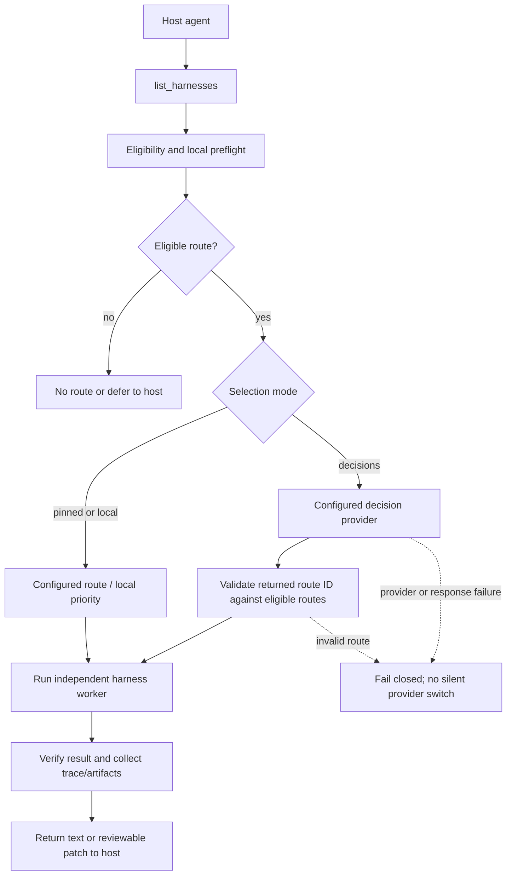

# harnessrouter

**one agent. multiple harnesses. one reviewable result.**

harnessrouter lets your current agent hand a bounded task to an independent Codex, Claude Code, OpenCode, or Pi worker through MCP. The worker can return text or a reviewable patch, with artifacts and execution traces. Your host agent keeps its context and owns the final answer.

The core capability is **cross-harness interoperability**. Better outcomes, speed, token use, and cost are goals to measure, not promises. Worker protocols are implemented and checked offline; a complete live host/worker matrix has not been verified. See [compatibility](docs/COMPATIBILITY.md) for current support and limits.

## what you can do

- Ask one agent to delegate a bounded review or coding task to another harness.
- Choose a configured worker and model, or let an enabled decision provider select from eligible routes.
- Run workers against isolated snapshots and review a patch before applying it.
- Inspect run status, artifacts, token measurements, elapsed time, and known cost coverage.
- Keep Codex, Claude Code, OpenCode, and Pi independent; MCP is the gateway between them.

## requirements

- macOS or Linux; Windows users can use WSL2. Native Windows is not supported.
- Node.js **22.19+ in the Node 22 line, or Node 24**.
- At least one supported worker installed and authenticated separately.

## install

Until an npm release is published, install from a checkout:

```bash
git clone https://github.com/ozgureyilmaz/harnessrouter.git
cd harnessrouter
npm ci
npm run build
npm link --ignore-scripts
```

The local command is `harnessrouter`. A locally built tarball can also be installed with `npm install -g /absolute/path/to/harnessrouter-VERSION.tgz`. Registry installation will be `npm install -g harnessrouter` after publication.

## configure a worker

Install and authenticate your chosen harness through its own supported setup. harnessrouter does not copy worker credentials into its JSON config, and it does not discover the models available to a worker.

Create and inspect a config:

```bash
harnessrouter init --config ./harnessrouter.config.json
harnessrouter doctor --config ./harnessrouter.config.json
```

`init` writes disabled examples with dry run enabled. To explicitly enable a Codex worker, update the generated config with your project path and a model supported by your local runtime/account:

```json
{
  "selector": "local",
  "dryRun": false,
  "allowExecution": true,
  "allowPaid": false,
  "workspaceRoots": ["/absolute/path/to/project"],
  "workerProfiles": [
    {
      "id": "codex-main",
      "adapter": "codex",
      "model": "REPLACE_WITH_SUPPORTED_MODEL",
      "enabled": true,
      "allowExecution": true,
      "allowUnknownCost": true,
      "priority": 10,
      "timeoutMs": 120000
    }
  ]
}
```

Run `doctor` again after editing. It checks local configuration and runtime compatibility; it does not prove authentication or make a model call. An incompatible runtime stays unavailable.

This example chooses local route priority and opts out of decision-provider selection. `init` defaults to `selector: "decisions"` with OpenAI Decisions; dry-run and execution gates remain closed until configured.

> **Cost and execution:** enabling a worker authorizes independent execution and usage whose per-run USD charge may be unknown. Native subscriptions or API accounts can incur usage even when `allowPaid` is `false`. Every worker task must set `allowUnknownCost: true`. Dry run validates routing without launching a worker.

### config and state files

Configuration defaults to `$XDG_CONFIG_HOME/harnessrouter/config.json` or `~/.config/harnessrouter/config.json`. Project config at `.harnessrouter/config.json` and project `.env` defaults load only when `HARNESSROUTER_TRUST_PROJECT_CONFIG=true`; review them before enabling that setting. Use `--config` or `HARNESSROUTER_CONFIG` for an explicit config path. Process environment takes precedence, and explicit `--config` files are trusted choices. Runtime data is stored outside the installed package, by default under `~/.local/state/harnessrouter`.

## connect your agent

Print an MCP snippet for the host you use:

```bash
harnessrouter mcp-config --host codex --config ./harnessrouter.config.json
```

Supported host names are `codex`, `claude-code`, `opencode`, and `pi`. Add the printed configuration through that client's normal MCP setup, then reload the connection. This command prints configuration; it does not edit host settings. `harnessrouter serve` starts the stdio server, and running `harnessrouter` without a subcommand also serves MCP.

The MCP server provides four tools: `list_harnesses`, `route_task`, `get_run`, and `cancel_run`. Start by inspecting eligible workers, then submit a bounded task. Example read-only request:

```json
{
  "schemaVersion": "1.1",
  "taskId": "readme-review-001",
  "prompt": "Read README.md and identify up to three concrete documentation gaps. Do not edit files.",
  "requirements": ["review"],
  "acceptanceCriteria": [],
  "desiredOutput": "text",
  "preferredRouteId": "codex-main:configured",
  "allowUnknownCost": true,
  "workspace": {
    "root": "/absolute/path/to/project",
    "mode": "read-only"
  }
}
```

For an edit, use `requirements: ["coding"]`, `desiredOutput: "patch"`, and `workspace.mode: "patch"`. Include untracked files only when the task needs them. Use a new task ID for new work; if a call times out, inspect `get_run` before retrying the same task.

### ask your agent

Once MCP is connected, prompts can be as simple as:

- “Use `list_harnesses` and ask the best available worker to review this module. Return the three highest-risk findings, with file and line references. Do not edit.”
- “Delegate this bounded change to the OpenCode worker. Return a patch limited to `src/router/` and explain how it meets the acceptance criteria.”
- “Check the latest run with `get_run`. Summarize its status, artifacts, elapsed time, token data, and any unknown cost.”

The host agent chooses whether to delegate, reviews the returned result, and remains responsible for the final response and for applying any patch.

## how routing works



Only reachable, enabled, policy-eligible routes are offered to decision selection. The router validates the selected route against that filtered set. A decision model selects a route; it does not configure or discover the worker's model. Unsupported tasks return a clear no-route/defer result rather than silently running elsewhere.

### route task sequence

```mermaid
sequenceDiagram
    actor User
    participant Host as Host agent
    participant MCP as harnessrouter MCP
    participant Policy as Eligibility and policy
    participant Decision as Decision provider (optional)
    participant Worker as Independent harness worker

    User->>Host: Request bounded task
    Host->>MCP: list_harnesses
    MCP->>Policy: Check configuration, reachability, and task eligibility
    Policy-->>MCP: Eligible routes (or no route)
    MCP-->>Host: Routes and capabilities
    Host->>MCP: route_task(task, workspace, budget)
    MCP->>Policy: Recheck gates and workspace rules
    alt Decision selection enabled
        Policy->>Decision: Request selection from eligible route IDs
        Decision-->>Policy: Candidate route ID
        Policy->>Policy: Validate candidate belongs to eligible set
    else Pinned route or local selection
        Policy->>Policy: Select configured eligible route
    end
    Policy->>Worker: Execute bounded task in isolated snapshot
    Worker-->>MCP: Text or patch plus execution result
    MCP->>MCP: Verify result and record trace/artifacts
    MCP-->>Host: HarnessResult, run ID, and artifact references
    Host-->>User: Review and summarize; apply patch only after review
```

## decision providers

Decision selection defaults to the OpenAI Decisions API, pinned to `gpt-6-luna`. Users can select TypeSafe JEV or local Ollaya; provider errors do not silently switch to another provider or local ranking.

| Provider | Setup |
| --- | --- |
| OpenAI Decisions | `OPENAI_API_KEY` |
| TypeSafe JEV | `TYPESAFE_API_KEY` or `JEV_API_KEY` |
| Ollaya local | System One-compatible API, default `http://127.0.0.1:11435`; `OLLAYA_API_KEY` is optional and local-only |
| Local ranking | Set `selector: "local"` to use configured priority or `preferredRouteId` without a decision API call |

Set `decisionProvider: "jev"` or `ROUTER_DECISION_PROVIDER=jev` to select JEV. See [decision provider configuration](docs/DECISION_PROVIDERS.md). The decision provider selects a route, not its model.

## measure time and tokens

```bash
harnessrouter stats --config ./harnessrouter.config.json --task-type coding --sort time
harnessrouter stats --config ./harnessrouter.config.json --task-type coding --sort tokens --json
```

Reports include measured elapsed time, canonical token counts, data coverage, criterion outcomes, and unknown costs. Host conversation usage is excluded. MCP clients can request `list_harnesses` with `includePerformance: true`. Measurements can help you choose a `preferredRouteId` or trusted profile priorities; sorting does not change routing or prove equivalent quality. Cached input and reasoning are counted once. Missing and legacy counters are not zeros. See [performance measurements and limits](docs/PERFORMANCE.md).

## workspace and security

Workers receive an isolated Git snapshot of tracked content, including existing dirty edits and deletions. Untracked files require explicit inclusion. The original repository is not automatically patched. Snapshot policy excludes known secret filenames, agent instructions, hooks, inherited harness settings, `.git`, and dependency directories; symlinks, hardlinks, and unsafe paths are rejected.

Patch results include `workspace.patch`, a changed-file manifest, the captured baseline fingerprint, and a SHA256 digest. Review the patch and account for later source edits before applying it. Applicability does not mean semantic correctness. Read-only writes, protected-file writes, Git metadata tampering, and empty requested patches fail explicitly.

Native workers are not uniformly sandboxed by the operating system. File exclusions and runtime tool restrictions cannot guarantee prevention of writes elsewhere or recognition of secrets under arbitrary filenames. See [security](SECURITY.md), [adapter boundaries](docs/ADAPTERS.md), and [security and cost](docs/SECURITY_AND_COST.md).

## optional specialists

The source checkout includes opt-in Pi browser and fal image routes. Pi runs a real RPC agent with isolated public-browser tools. Browser actions do not support login, forms, payments, downloads, or private profiles. Fal uses model-specific planning, budget admission, durable request tracking, bounded recovery, and decoded image verification. Video generation is disabled. Composed tasks pass observations into a separate task with parent/context provenance.

Specialist execution requires `ROUTER_ALLOW_PAID_RUNS=true`, `ROUTER_DRY_RUN=false`, and finite approved budgets. Pi browser execution additionally requires `ROUTER_ALLOW_EXECUTION=true` and task `allowUnknownCost: true`, regardless of decision provider. Unknown native host/Pi subscription USD is not capped by priced reservations.

For local setup, copy `config/.env.example` to an ignored `.env`, protect it with `chmod 600 .env`, and edit it locally. Set `HARNESSROUTER_TRUST_PROJECT_CONFIG=true` only after reviewing project configuration. `OPENAI_API_KEY` may also authenticate a Pi OpenAI provider; configure Pi through its documented provider authentication rather than an invented `PI_API_KEY`. `FAL_KEY` supplies fal. `doctor` reports credential presence and configured loopback URLs only; it makes no provider or model request.

Daily-use examples are in [config/daily-tasks.json](config/daily-tasks.json):

```bash
npm run domain:allow -- developer.mozilla.org
npm run task:compose -- <browser-run-id>
```

Reload MCP after changing allowlists or rebuilding. `ROUTER_IMAGE_ROUTE=fast|quality` pins an image profile and skips a selection call; task `creativeOptions.quality=fast|high` overrides it. `auto` allows both profiles. Browser link targets are recorded in `websiteObservations.links`; the related acceptance criterion is `Measured href`.

## development

```bash
npm ci
npm run typecheck
npm test
npm run build
npm run package:check
npm run package:smoke
```

Default tests use local fixtures/provider doubles; skipped opt-in live tests are not live evidence. CI supplies no provider credentials and makes no model calls. Contributor setup and verification are in [CONTRIBUTING.md](CONTRIBUTING.md); protocol details and extension interfaces are in [docs/ADAPTERS.md](docs/ADAPTERS.md).

## demos and evidence

The [recorded Pages demo](https://ozgureyilmaz.github.io/harnessrouter/) replays captured specialist artifacts without provider calls. Historical runs do not establish the current native worker matrix. A browser-only pilot recorded native 4/4 versus Pi 3/4 task checks with different timing boundaries. A host-only composed run remained partial and failed exact 16:9. The [three-pair creative pilot](demo/creative-pilot-20261012.md) established no quality or efficiency advantage; total host/Pi USD was unknown.

See [current status review](docs/CURRENT_STATUS_REVIEW.md), [compatibility](docs/COMPATIBILITY.md), [live pilot methods](docs/LIVE_EVALUATION.md), [recorded pilot results](docs/LIVE_EVALUATION_RESULTS.md), [metering](docs/LOCAL_METERING.md), and [open-source release gates](docs/OPEN_SOURCE_RELEASE.md). `npm run eval:pilot` checks contracts offline; live evaluation and benchmark commands launch real work and require execution/spend authorization. Missing counters remain unavailable and estimates remain distinct from invoices.

The [Pages workflow](.github/workflows/pages.yml) publishes only `demo/preview/`. See [demo publishing notes](demo/preview/README.md) for export and validation. Preview locally with `python3 -m http.server 4173 --bind 127.0.0.1 --directory demo/preview`.

[architecture](docs/ARCHITECTURE.md) · [runbook](docs/RUNBOOK.md) · [security and cost](docs/SECURITY_AND_COST.md) · [license](LICENSE)
