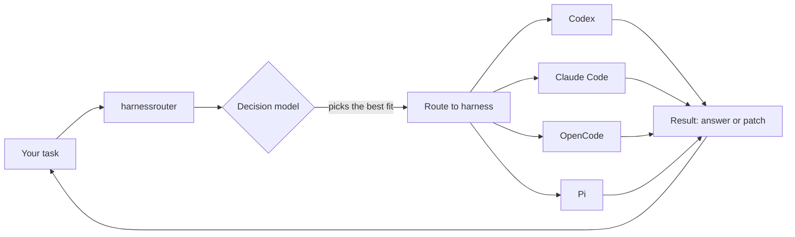
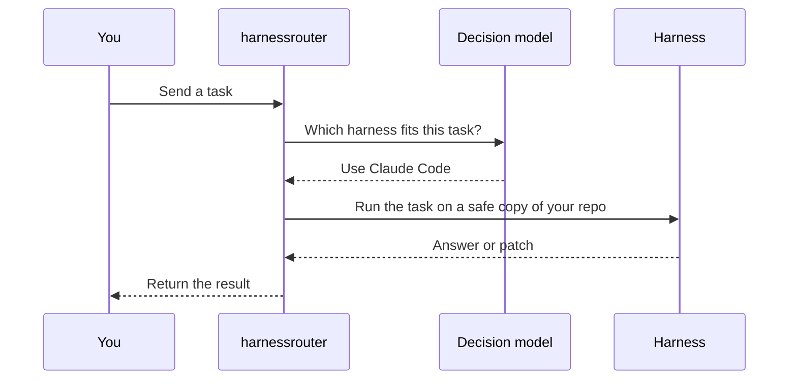

# harnessrouter

*one agent. many harnesses.*

local harnessrouter. your current agent hands a bounded task to codex, claude code, opencode, pi, and more. a decision model picks the best harness for each task, runs it on an isolated git snapshot, and gives you back text or a patch to review.

[](https://github.com/ozgureyilmaz/harnessrouter/actions)
[](https://opensource.org/licenses/MIT)
[](https://deepwiki.com/ozgureyilmaz/harnessrouter)

## features

cross-harness workers: codex, claude code, opencode, and pi stay independent. mcp is the gateway.

route choice: a decision model picks the harness. local priority is the keyless default. pin a worker, or enable a hosted provider with `--selector decisions`.

isolated work: the worker gets a git snapshot. edits return as a patch. your repository is not changed for you.

inspectable runs: `list_harnesses`, `route_task`, `get_run`, and `cancel_run`.

## how it works



the decision model step is whichever selector is configured, local priority rules by default or the hosted decision model when enabled with `--selector decisions`.

a decision model chooses the harness for the task. the keyless default from `init` is local priority rules acting as that decision model: no provider call and no api key. equal top priorities defer to the host. `--selector decisions` or `--decision-provider` enables the hosted decision model. openai decisions (`gpt-6-luna`) is the default provider. jev and loopback ollaya are the other providers. the provider returns a route id and does not choose the worker model. a bad id, or a provider error, stops the run instead of switching providers. see [decision providers](docs/DECISION_PROVIDERS.md) and [architecture](docs/ARCHITECTURE.md).



the same `taskId` returns a finished run. if a call times out, use `get_run` before sending that task again.

## requirements

macos or linux. windows through wsl2.

node.js 22.19+ on the node 22 line, or node 24.

git, and at least one worker installed and signed in on its own.

## install

until an npm release is published, install from a checkout:

```bash
git clone https://github.com/ozgureyilmaz/harnessrouter.git
cd harnessrouter
npm ci
npm run build
npm link --ignore-scripts
```

the command is `harnessrouter`. after `npm pack`, a local tarball installs with `npm install -g /absolute/path/to/harnessrouter-1.0.0.tgz`.

## setup

create a starter file. it ships with dry run on, execution off, and every worker disabled:

```bash
harnessrouter init --config ./harnessrouter.config.json
```

enable one worker. use a model your installed runtime accepts, and an absolute project path:

```json
{
  "selector": "local",
  "dryRun": false,
  "allowExecution": true,
  "allowPaid": false,
  "workspaceRoots": ["/absolute/path/to/project"],
  "workerProfiles": [
    {
      "id": "codex-main",
      "adapter": "codex",
      "model": "REPLACE_WITH_SUPPORTED_MODEL",
      "enabled": true,
      "allowExecution": true,
      "allowUnknownCost": true,
      "priority": 10,
      "timeoutMs": 120000
    }
  ]
}
```

```bash
harnessrouter doctor --config ./harnessrouter.config.json
```

`doctor` checks node, git, and the worker cli. it does not call a model. worker logins stay in each harness. this file does not store them.

`init` writes `selector: "local"`. local priority rules act as the decision model, so this path needs no api key and does not call a provider. dry run stays on, execution stays off, and paid calls stay off until you change them. a worker can spend its own subscription or api account, and the usd amount may be unknown, so each task sets `allowUnknownCost` to true.

enable the hosted decision model when you create the file. openai is the default provider. jev and ollaya are the others:

```bash
harnessrouter init --selector decisions --decision-provider openai --config ./harnessrouter.config.json
```

providers are `openai`, `jev`, and `ollaya`. `--decision-provider` alone also selects `decisions`. `--selector local` together with `--decision-provider` is rejected. see [decision providers](docs/DECISION_PROVIDERS.md).

a config file that leaves `selector` out, and a process with no config file, still use `decisions` with openai. that keeps older files on the same fail-closed path: hosted selection does not run without its key and the paid and execution gates. set `"selector": "local"` in the file, or `ROUTER_SELECTOR=local`, to switch them. an older init file that already says `"selector": "decisions"` is unchanged.

config defaults to `~/.config/harnessrouter/config.json` (`$XDG_CONFIG_HOME` when set). run data defaults to `~/.local/state/harnessrouter`. process environment overrides the file. spend and snapshot limits: [security and cost](docs/SECURITY_AND_COST.md).

print an mcp snippet and paste it into the host. this does not edit host settings:

```bash
harnessrouter mcp-config --host codex --config ./harnessrouter.config.json
```

hosts are `codex`, `claude-code`, `opencode`, and `pi`. reload the host after you add the snippet. `harnessrouter` with no subcommand serves mcp on stdio.

## usage

### cli

```bash
harnessrouter doctor --config ./harnessrouter.config.json
harnessrouter stats --config ./harnessrouter.config.json --task-type coding --sort time
harnessrouter stats --config ./harnessrouter.config.json --task-type coding --sort tokens --json
```

`stats` reads saved runs. sorting does not change routing. see [performance](docs/PERFORMANCE.md).

### with your agent

after mcp is connected, ask things like:

- "use `list_harnesses`, then ask the best available worker to review this module. three findings, with file and line references. do not edit."
- "delegate this change to the opencode worker. return a patch limited to `src/router/`."
- "call `get_run` for the latest run and summarize status, artifacts, time, and tokens."

a read-only `route_task` looks like this. the route id is the profile id plus `:configured`.

```json
{
  "schemaVersion": "1.1",
  "taskId": "readme-review-001",
  "prompt": "Read README.md and name up to three concrete documentation gaps. Do not edit files.",
  "requirements": ["review"],
  "acceptanceCriteria": [],
  "desiredOutput": "text",
  "preferredRouteId": "codex-main:configured",
  "allowUnknownCost": true,
  "workspace": {
    "root": "/absolute/path/to/project",
    "mode": "read-only"
  }
}
```

for an edit, use `requirements` `["coding"]`, `desiredOutput` `"patch"`, and `workspace.mode` `"patch"`. you review the patch before applying it. known secret names, `.git`, and dependency directories stay out of the snapshot. see [security](SECURITY.md) and [adapters](docs/ADAPTERS.md).

a source checkout can also turn on a pi browser route and a fal image route. they stay off until you opt in. [compatibility](docs/COMPATIBILITY.md).

## development

```bash
npm ci
npm run typecheck
npm test
npm run build
npm run package:check
```

tests use local fixtures. ci does not call a model. contributor notes: [contributing](CONTRIBUTING.md).

## links

- [issues](https://github.com/ozgureyilmaz/harnessrouter/issues)
- [mcp docs](https://modelcontextprotocol.io/docs)
- [architecture](docs/ARCHITECTURE.md)
- [compatibility](docs/COMPATIBILITY.md)
- [decision providers](docs/DECISION_PROVIDERS.md)
- [adapters](docs/ADAPTERS.md)
- [performance](docs/PERFORMANCE.md)
- [security and cost](docs/SECURITY_AND_COST.md)
- [security](SECURITY.md)
- [contributing](CONTRIBUTING.md)
- [code of conduct](CODE_OF_CONDUCT.md)
- [deepwiki](https://deepwiki.com/ozgureyilmaz/harnessrouter)
