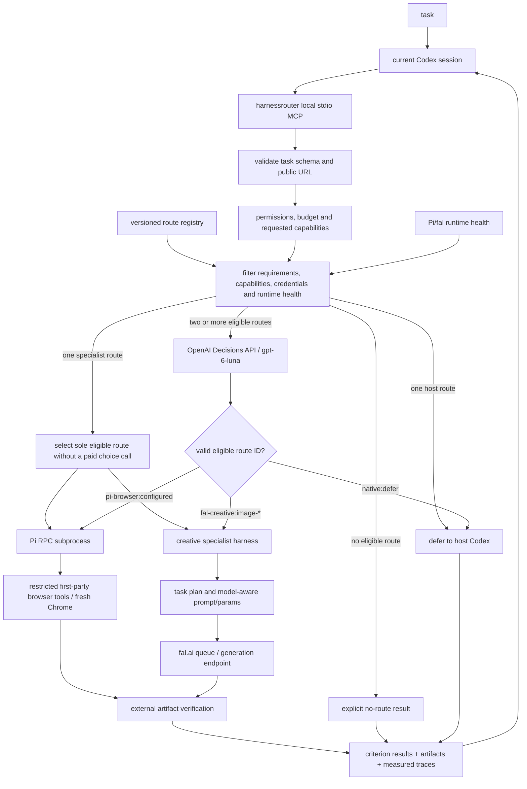
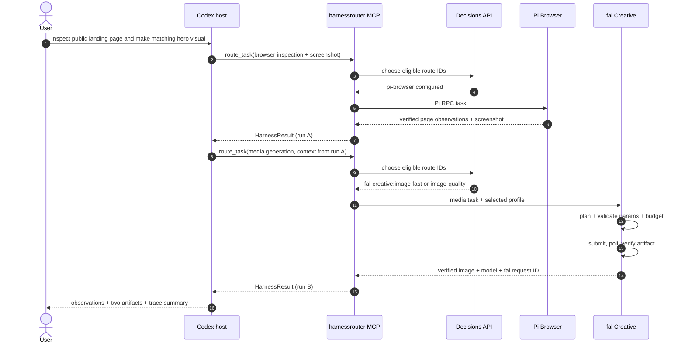
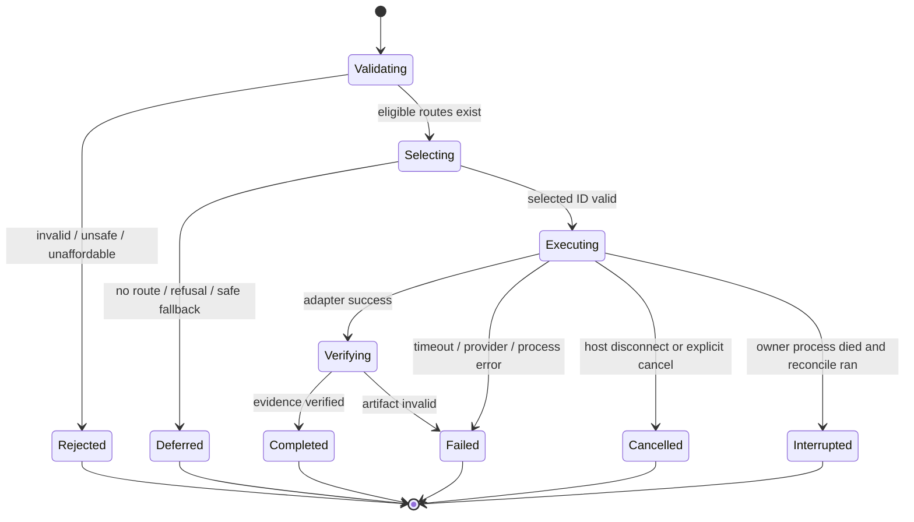

# Architecture & execution contracts

A new `harnessrouter init` file uses local priority (`selector: "local"`) and does not call a decision provider. The diagram below shows the decisions path used when `selector` is `decisions`, including the compatibility default for a config that omits `selector`. Local priority and a single eligible route skip that call. See [decision providers](DECISION_PROVIDERS.md). Optional named route profiles are an extra choosable route on a worker; see [route profiles](ROUTE_PROFILES.md). Configs that omit them keep one `workerId:configured` route. The MCP instructions and tool descriptions are a short cookbook; the full host rules are in [host guidance](HOST_GUIDANCE.md).

## System diagram



## Two-harness composition (no hidden orchestration)



## Boundaries

**Host:** current Codex orchestrates and constructs subtasks; it owns final response to user. **MCP:** route/request validation and provider-independent result. **Registry and eligibility:** expose only runnable authorized routes after task requirements, requested capabilities, permissions, credentials, budget and health checks. **Decisions:** semantic choice among already eligible route IDs. **Adapters:** spawn/control execution runtimes. A worker receives no extra MCP servers unless its profile sets `mcpServers`; traces keep names and command basenames, and `startServer` refuses to run when `HARNESSROUTER_WORKER=1`. See [tool pass-through](TOOL_PASSTHROUGH.md). **Verifier:** independently checks supported artifact and browser evidence; criterion outcomes remain `unverified` when evidence is insufficient. It does not assess artistic merit. **Trace sink:** separate timestamps and error taxonomy.

## Contract approach

See `contracts/task.schema.json`, `contracts/result.schema.json`, `contracts/harness-manifest.schema.json`, `contracts/decision-trace.schema.json`. All schema IDs use local draft 2020-12 and must have runtime validation in implementation.

Core TypeScript interfaces are implemented under `src/domain/`. Tasks may add `requiredCapabilities`; `HarnessResult` v1.2 reports criterion evidence, token usage, and per-provider cost components while retaining v1.1 read compatibility:

```ts
interface HarnessAdapter {
  id: string;
  health(): Promise<{available: boolean; reason?: string}>;
  execute(task: HarnessTask, ctx: ExecutionContext): Promise<HarnessResult>;
  cancel?(runId: string): Promise<void>;
}
interface ExecutionContext {
  runId: string;
  routeId: string;
  modelProfileId?: string;
  budgetUsd?: number;
  signal: AbortSignal;
  artifactsDir: string;
}
interface CriterionResult {
  criterion: string;
  status: 'passed' | 'failed' | 'unverified';
  verifier: 'artifact' | 'browser_observation' | 'provider_metadata' | 'planner_provenance' | 'none';
  evidence?: string;
}
```

## Request processing details

1. Parse structured task; validate requested output and acceptance criteria; reject unsupported high-risk actions.
2. Read registry; filter by enabled status, task requirements and required capabilities, budget, model compatibility, credentials, permissions, timeouts and **real runtime health**.
3. Construct Decisions `choice` only from eligible alternatives; include task + constraints + sanitized evidence of route capabilities/price/latency history (where known).
4. If two or more routes are eligible, reject refusal, timeout, malformed response, or any route not offered by Decisions. If exactly one specialist route is eligible, select it deterministically and mark the decision trace `not_required`; if paid Decisions calls are unauthorized, exclude external routes before selection.
5. Execute adapter with bounded resources; produce trace across eligibility / decision / handoff / generation / verification.
6. Verify supported artifact and browser evidence, evaluate each acceptance criterion only where deterministic evidence exists, and save normalized `HarnessResult` v1.2. Return to Codex. `defer_to_host` is a control result, **not** an automatically executed native action or verified task completion.
7. A synchronous MCP `route_task` emits `notifications/progress` about every 12 seconds when the request carries a progress token. The message names the stage (`validating`, `selecting`, `executing`, `collecting`) and the elapsed time. Hosts that reset their request timeout on progress can outlive the SDK's 60 second default.
8. `async: true` returns `{runId, taskId, status: "running"}` once the run record exists. That background run is not aborted when the acknowledgement request ends. The default remains synchronous.
9. `get_run` reads a run by `runId`, or by `taskId` through `artifactsDir/tasks/<sha256(taskId)>.json`. The index points at the latest run. Earlier run ids stay readable.

## Joint harness/model selection

`gpt-6-luna` is the Decisions **decision model**. The chosen execution route has a separate `harness_id`, and may have `agent_model_profile` (Pi) or `generation_model_id` (fal). Registry values must be verified against actual configured provider capabilities. Avoid offering cross-product pairs unsupported by a runtime. For fal, the outer route selects a constrained model profile; the creative harness decides prompt, parameters, attempt strategy for that profile. For Pi, the model may be fixed to `configured`, unless Pi is proven to support the alternate in the current environment.

## Failure state machine



`completed` and `failed` are idempotent for the same `taskId` and fingerprint. `cancelled` covers a host timeout or disconnect (`client_disconnected`) and an explicit `cancel_run` (`cancelled`). `interrupted` is written by reconcile when the lease owner is gone. Both `cancelled` and `interrupted` may be submitted again with the same `taskId`; the previous run record is kept. `rejected`, `permission_required`, and `defer_to_host` are returned again unchanged.

## Crash recovery and snapshot lifetime

Every worker profile has one lease under `artifactsDir/worker-leases/`. The lease stores the pid, hostname, boot id, and process start time. Reconcile runs when the server starts, before a lease is acquired, and from `harnessrouter reconcile [--dry-run]`.

- A dead pid (`ESRCH`), another hostname, another boot, or a reused pid is terminal. The run becomes `interrupted`, an event is appended to `events.jsonl`, the lease is removed, and the snapshot is deleted. Linux reads the start time from `/proc/<pid>/stat` and the boot id from `/proc/sys/kernel/random/boot_id`. macOS reads another process's elapsed time with `ps -o etime` and the boot id from `kern.bootsessionuuid`. The router's own pid uses its process uptime, because that pid cannot have been reused while this process is running.
- A live pid is never changed. A second caller for that profile receives `worker_busy`.
- `worker_reconciliation_required` remains only when the pid exists but its start time cannot be read, so pid reuse cannot be ruled out.

`harnessrouter prune [--older-than 7d] [--dry-run]` removes run directories older than the cutoff. It never removes a run with a live lease, and it never removes a lease reconcile cannot classify. Budget files beside the run directories are left in place.

The worker adapter deletes the snapshot workspace and OpenCode isolation directories in a `finally` block after output is collected and the lease is released. `status.json`, `events.jsonl`, and the saved patch remain. `keepSnapshots` defaults to false (`HARNESSROUTER_KEEP_SNAPSHOTS=1` keeps them). Optional `snapshotExclude` and `snapshotInclude` globs add workspace rules. An include cannot restore `.git`.

Snapshot rules match control directories by exact path segment and secret files by exact basename or basename glob. A directory whose name merely contains `auth`, `token`, `secret`, or `hooks` is included. Git hooks are excluded only at `.git/hooks` and `.husky`. The `worker.started` event and the run result record `workspaceExclusions` with the full count and up to 50 paths. Workspace paths still fail closed on symlinks. The only exception is macOS, where `/tmp` and `/var` are accepted solely when they point at `/private/tmp` and `/private/var`.

## Implemented project areas

```text
src/
  index.ts               # stdio MCP bootstrap
  domain/{types,errors,schemas}.ts
  registry/{loader,eligibility}.ts
  routing/{decisions,selector}.ts
  harnesses/{adapter,pi-browser,fal-creative}.ts
  harnesses/creative/{planner,model-profiles,queue,verify}.ts
  transport/{pi-rpc}.ts
  observability/{trace,artifacts}.ts
  mcp/{tools}.ts
tests/{unit,integration,e2e}/
artifacts/               # .gitignore; actual outputs, never fake
```

## Official references

These are the upstream pages the implementation follows. Installed CLIs and model schemas can move; check the current page before copying an example.

- [OpenAI Decisions](https://developers.openai.com/api/docs/guides/decisions) for `choice` requests and `gpt-6-luna`.
- [Codex MCP](https://developers.openai.com/codex/mcp) for local stdio registration.
- [Pi RPC](https://pi.dev/docs/latest/rpc) for the long-running JSONL subprocess.
- [fal queue](https://fal.ai/docs/model-endpoints/queue) for submit, status, and result. Profile endpoints are in [fal image profiles](FAL_PROFILES.md).
- TypeSafe and Ollaya are documented in [decision providers](DECISION_PROVIDERS.md).
