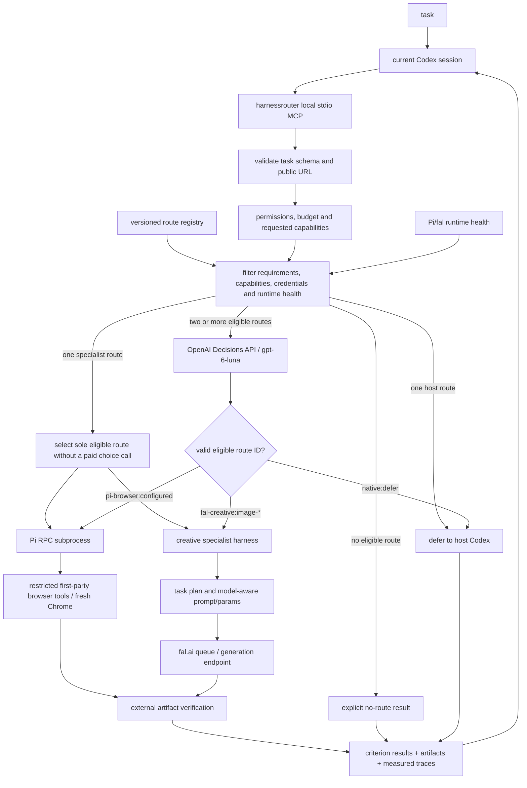
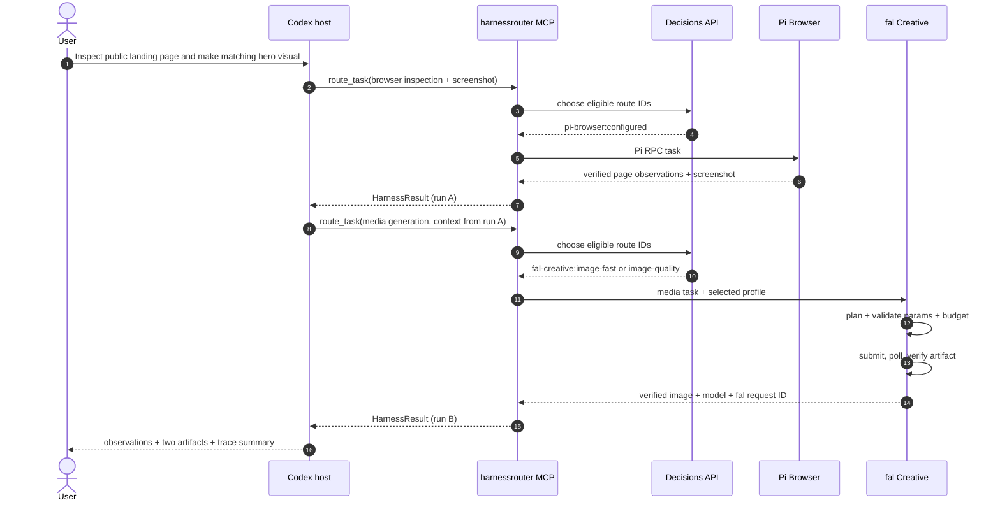
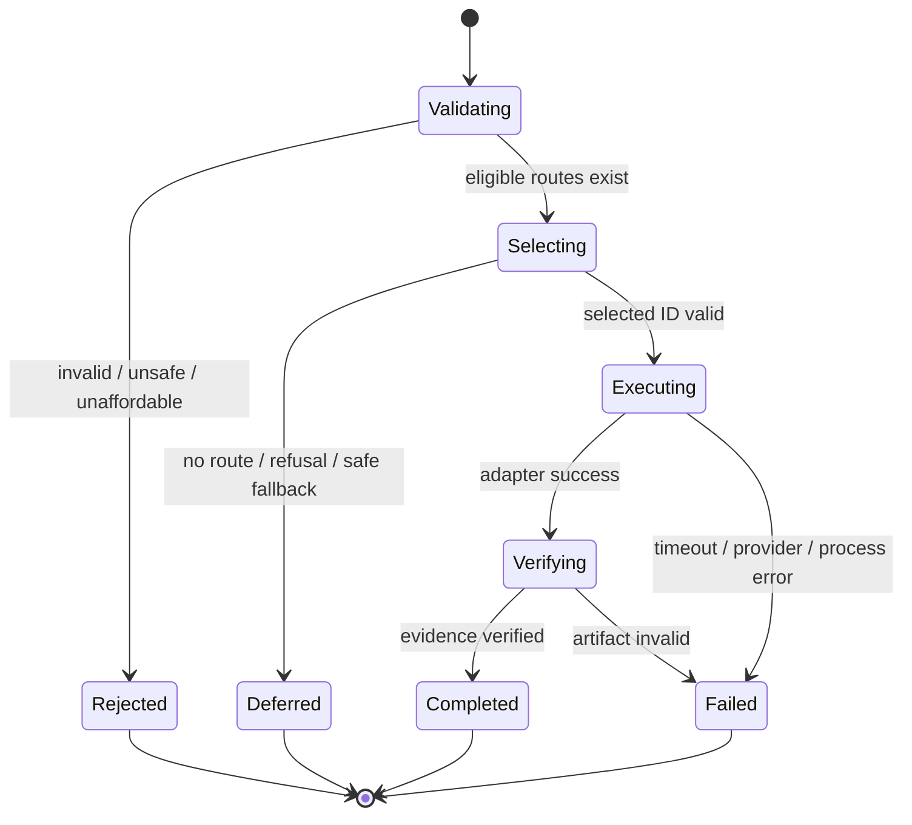

# Architecture & execution contracts

## System diagram



## Two-harness composition (no hidden orchestration)



## Boundaries

**Host:** current Codex orchestrates and constructs subtasks; it owns final response to user. **MCP:** route/request validation and provider-independent result. **Registry and eligibility:** expose only runnable authorized routes after task requirements, requested capabilities, permissions, credentials, budget and health checks. **Decisions:** semantic choice among already eligible route IDs. **Adapters:** spawn/control execution runtimes. **Verifier:** independently checks supported artifact and browser evidence; criterion outcomes remain `unverified` when evidence is insufficient. It does not assess artistic merit. **Trace sink:** separate timestamps and error taxonomy.

## Contract approach

See `contracts/task.schema.json`, `contracts/result.schema.json`, `contracts/harness-manifest.schema.json`, `contracts/decision-trace.schema.json`. All schema IDs use local draft 2020-12 and must have runtime validation in implementation.

Core TypeScript interfaces are implemented under `src/domain/`. Tasks may add `requiredCapabilities`; `HarnessResult` v1.2 reports criterion evidence, token usage, and per-provider cost components while retaining v1.1 read compatibility:

```ts
interface HarnessAdapter {
  id: string;
  health(): Promise<{available: boolean; reason?: string}>;
  execute(task: HarnessTask, ctx: ExecutionContext): Promise<HarnessResult>;
  cancel?(runId: string): Promise<void>;
}
interface ExecutionContext {
  runId: string;
  routeId: string;
  modelProfileId?: string;
  budgetUsd?: number;
  signal: AbortSignal;
  artifactsDir: string;
}
interface CriterionResult {
  criterion: string;
  status: 'passed' | 'failed' | 'unverified';
  verifier: 'artifact' | 'browser_observation' | 'provider_metadata' | 'planner_provenance' | 'none';
  evidence?: string;
}
```

## Request processing details

1. Parse structured task; validate requested output and acceptance criteria; reject unsupported high-risk actions.
2. Read registry; filter by enabled status, task requirements and required capabilities, budget, model compatibility, credentials, permissions, timeouts and **real runtime health**.
3. Construct Decisions `choice` only from eligible alternatives; include task + constraints + sanitized evidence of route capabilities/price/latency history (where known).
4. If two or more routes are eligible, reject refusal, timeout, malformed response, or any route not offered by Decisions. If exactly one specialist route is eligible, select it deterministically and mark the decision trace `not_required`; if paid Decisions calls are unauthorized, exclude external routes before selection.
5. Execute adapter with bounded resources; produce trace across eligibility / decision / handoff / generation / verification.
6. Verify supported artifact and browser evidence, evaluate each acceptance criterion only where deterministic evidence exists, and save normalized `HarnessResult` v1.2. Return to Codex. `defer_to_host` is a control result, **not** an automatically executed native action or verified task completion.

## Joint harness/model selection

`gpt-6-luna` is the Decisions **decision model**. The chosen execution route has a separate `harness_id`, and may have `agent_model_profile` (Pi) or `generation_model_id` (fal). Registry values must be verified against actual configured provider capabilities. Avoid offering cross-product pairs unsupported by a runtime. For fal, the outer route selects a constrained model profile; the creative harness decides prompt, parameters, attempt strategy for that profile. For Pi, the model may be fixed to `configured`, unless Pi is proven to support the alternate in the current environment.

## Failure state machine



## Implemented project areas

```text
src/
  index.ts               # stdio MCP bootstrap
  domain/{types,errors,schemas}.ts
  registry/{loader,eligibility}.ts
  routing/{decisions,selector}.ts
  harnesses/{adapter,pi-browser,fal-creative}.ts
  harnesses/creative/{planner,model-profiles,queue,verify}.ts
  transport/{pi-rpc}.ts
  observability/{trace,artifacts}.ts
  mcp/{tools}.ts
tests/{unit,integration,e2e}/
artifacts/               # .gitignore; actual outputs, never fake
```
